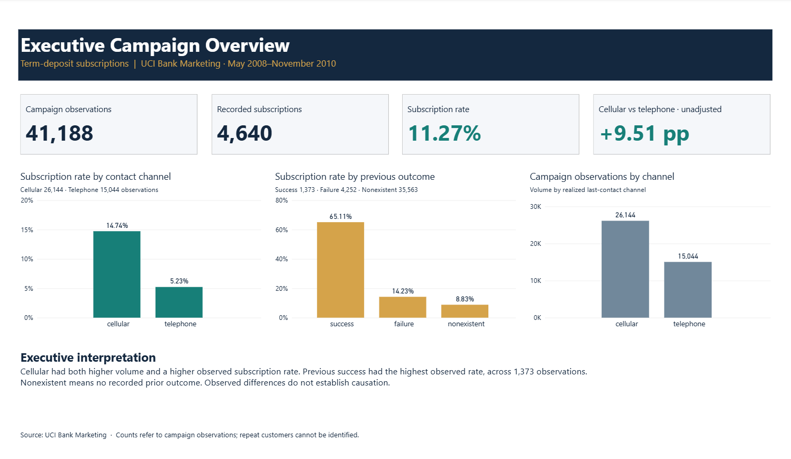

# Bank Campaign Intelligence
### Turning Campaign Data into Better Marketing Decisions

**Banking Analytics & Business Intelligence**

*Self-directed analytical consulting simulation using the publicly available UCI Bank Marketing dataset.*

**[View the Executive Case Study (PDF)](docs/P003_Bank_Campaign_Executive_Case_Study.pdf)**

## The Business Challenge

Banks invest time and resources contacting prospective customers about financial products. But when one contact channel appears more successful than another, the explanation isn't always straightforward.

Higher subscription rates might reflect the communication channel, previous customer interactions, campaign timing, or differences in the groups being contacted.

**The objective:** Evaluate historical marketing performance, investigate the factors associated with subscription outcomes, and help marketing managers make more informed campaign decisions.

## The Investigation

I analyzed **41,188 historical outreach observations** from a Portuguese bank, covering campaigns conducted between 2008 and 2010.

The investigation focused on three business questions:

1. How successfully did the bank's outreach efforts generate term-deposit subscriptions?
2. Did the apparent performance difference between cellular and telephone contacts persist when comparing groups more fairly?
3. Which customer-history patterns and data-quality issues should managers understand before making campaign decisions?

I developed a reproducible analytical workflow and a two-page Power BI report to investigate these questions.

## What the Analysis Revealed

### 1. Campaign performance varied substantially by contact channel

Across the historical records, **4,640 of 41,188 observations resulted in subscriptions**, an overall rate of **11.27%**.

| Recorded contact channel | Subscriptions | Observations | Subscription rate |
|---|---:|---:|---:|
| Cellular | 3,853 | 26,144 | **14.74%** |
| Telephone | 787 | 15,044 | **5.23%** |

The observed difference was **9.51 percentage points** in favor of cellular.

**Why it matters:** A substantial difference deserves investigation, but an initial comparison alone is not enough to justify changing a marketing strategy.

### 2. A more careful comparison changed the interpretation

I examined whether the observed channel gap persisted after separately accounting for previous campaign outcomes and calendar-month composition.

| Comparison | Cellular-minus-telephone gap |
|---|---:|
| Initial observed comparison | **+9.51 percentage points** |
| Compared under a common previous-outcome mix | **+6.43 percentage points** |
| Compared under a common supported-month mix | **+8.04 percentage points** |

The gap became smaller under both comparisons but remained positive.

**Why it matters:** Comparing groups under shared conditions provides a more informative description of performance. However, the findings do not prove that selecting cellular contact would cause more subscriptions.

The two adjusted comparisons address different factors independently. They are not a combined adjustment for all potential differences.

### 3. Previous campaign history revealed important differences

Recorded subscription rates differed considerably by previous campaign outcome:

- **Previous success:** 65.11%
- **Previous failure:** 14.23%
- **No previous outcome recorded:** 8.83%

**Why it matters:** Historical interaction records may help explain differences in campaign results. Before using them operationally, a bank would need to verify data quality, decision-time availability, and appropriate customer treatment.

The audit also identified **4,110 observations** where a special previous-contact code appeared alongside records of positive prior contacts and a previous failure. These inconsistencies warrant investigation rather than automatic correction.

## Recommended Business Actions

| Priority | Recommendation | Business purpose |
|---|---|---|
| 1 | Investigate channel performance within comparable outreach groups | Avoid misleading channel comparisons |
| 2 | Improve collection of customer, campaign, and contact-history identifiers | Support more reliable measurement and follow-up |
| 3 | Validate conflicting campaign-history fields | Reduce ambiguity in reporting and operational decisions |
| 4 | Evaluate proposed outreach changes through a controlled pilot | Test whether a strategy actually improves outcomes |
| 5 | Capture campaign costs and measurable financial outcomes | Enable future profitability and return-on-investment analysis |

**Central takeaway:** Good campaign intelligence is not simply identifying which group has the highest subscription rate. It is understanding what the available evidence supports, what remains uncertain, and which decisions require further testing.

These recommendations are proposed next steps, not completed business interventions.

## Power BI Dashboard

A two-page Power BI report presents the investigation through executive summaries and detailed campaign comparisons.

### Executive Campaign Overview

Provides a management-level view of subscription performance, contact-channel rates, prior campaign outcomes, and supporting observation counts.

### Channel & Campaign Performance

Explores channel comparisons, calendar patterns, campaign contact frequency, and standardized results with visible sample-support limitations.

Both dashboard pages were loaded and refreshed in Power BI Desktop during project validation.

## Project Deliverables

This project demonstrates an analytical engagement from source-data verification through executive reporting.

- **Power BI Report:** Two pages presenting campaign performance and investigative comparisons.
- **Executive Case Study:** Business-oriented explanation of findings, implications, and recommendations.
- **PostgreSQL Reporting Layer:** Structured data staging and analytical aggregation.
- **Python Verification Workflow:** Independent reconciliation, reproducible exports, and quality controls.
- **Analytical Documentation:** Detailed methodology, support thresholds, limitations, and source attribution.

### Explore the Supporting Evidence

- [Detailed Portfolio Case Study](docs/portfolio-case-study.md)
- [Customer Segmentation Findings](reports/segmentation-findings.md)
- [Complete Analytical Tables](reports/segmentation-tables.md)
- [Statistical Limitations](reports/statistical-limitations.md)
- [Power BI Reporting Definitions](docs/powerbi-reporting-layer.md)

## Technical Documentation & Quality Assurance

**Technologies:** PostgreSQL, SQL, Python, Power BI, DAX, PBIP/PBIR, and TMDL.

The analytical workflow preserves the verified source snapshot and uses explicit subscription counts and eligible observation denominators.

Its reporting layer contains **12 aggregate tables and 383 summary rows**.

Independent Python verification checks source fingerprints, group counts, rates, adjustment weights, exclusions, and reporting outputs. The repository documents successful database regression tests and Power BI project validation.

| Technical resource | Documentation |
|---|---|
| Dataset provenance and acquisition | [Source Documentation](docs/provenance.md) |
| Reporting definitions | [Analytical Contract](docs/analytical-contract.md) |
| PostgreSQL setup and staging | [Ingestion Guide](docs/postgresql-ingestion.md) |
| SQL reporting architecture | [Reporting Layer](docs/powerbi-reporting-layer.md) |
| Analytical verification | [Segmentation QA](reports/segmentation-qa.md) |
| Export reconciliation | [Power BI Export QA](reports/powerbi-export-qa.md) |
| Power BI implementation | [Power BI Project Guide](powerbi/README.md) |
| Dashboard validation | [Power BI Foundation QA](reports/powerbi-foundation-qa.md) |

### Reproducing the Project

The repository contains the analysis code, Power BI project definitions, dashboard previews, verification scripts, and supporting documentation.

To reproduce the analysis, acquire the public source dataset, follow the documented PostgreSQL staging workflow, generate the verified reporting bundle, and configure the Power BI project's local data-folder parameter.

Raw snapshot copies, reporting CSV exports, and Desktop caches are excluded from the public repository. The pinned reporting bundle must be regenerated locally before a fresh Power BI checkout can be refreshed.

Detailed reproduction instructions are available in the [Power BI Project Guide](powerbi/README.md).

## Scope & Limitations

This project uses historical outreach records from one Portuguese bank during **2008–2010**. The findings should not be generalized automatically to present-day banking campaigns.

Important limitations include:

- The unit of analysis is an outreach observation, not a verified unique customer.
- Customer and campaign identifiers are unavailable, so repeat observations cannot be reliably linked.
- Contact channel describes the recorded last contact, not a randomly assigned outreach strategy.
- Previous-outcome and calendar-month standardizations are separate descriptive comparisons, not causal estimates.
- Calendar months are pooled across years.
- Small comparison groups are subject to documented support requirements. December's 182 observations are excluded from the month-standardized channel comparison, although they remain in the overall results.
- Campaign costs and financial returns were not provided, so realized profitability and ROI cannot be calculated.
- No implemented intervention, measurable business improvement, or predictive performance is claimed.

**This is a self-directed portfolio project, not a completed commercial engagement.** The dashboards, analysis, and recommendations demonstrate professional analytical capabilities using historical public data.

## Data Source & Attribution

Moro, S., Rita, P., & Cortez, P. (2014). *Bank Marketing*. UCI Machine Learning Repository.

- [Dataset DOI: 10.24432/C5K306](https://doi.org/10.24432/C5K306)
- [Dataset License: CC BY 4.0](https://creativecommons.org/licenses/by/4.0/)
- [Dataset Provenance](docs/provenance.md)

Original project code is distributed under the repository's [MIT License](LICENSE). Bundled Microsoft JSON schemas retain their separate licensing terms, documented in the [Microsoft notice](powerbi/tools/MICROSOFT-SCHEMAS-LICENSE.txt).
