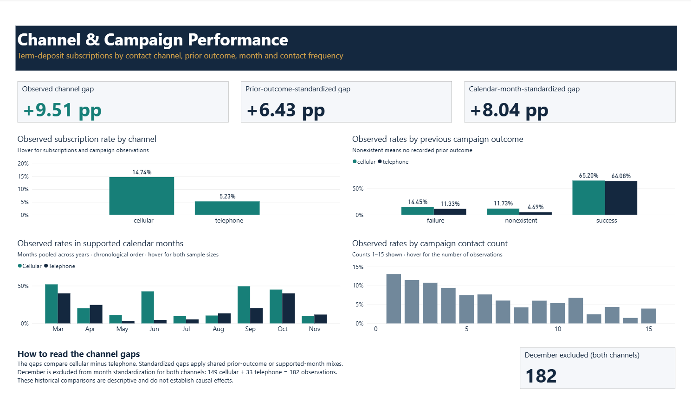

# P003 Bank Campaign Intelligence

A two-page Power BI report on historical term-deposit outreach at a Portuguese bank. The business question is whether the observed subscription-rate gap between cellular and telephone contacts remains after comparing the channels under a shared mix of previous campaign outcomes or supported calendar months.

**Tools** — PostgreSQL for staging and reconciliation, SQL for reporting and standardization, Python for snapshot verification and deterministic exports, and Power BI for the semantic model and report.

## Key findings

| Comparison | Validated result |
|---|---:|
| Overall observed subscription rate | **11.27%** · 4,640 / 41,188 observations |
| Observed cellular rate | **14.74%** · 3,853 / 26,144 observations |
| Observed telephone rate | **5.23%** · 787 / 15,044 observations |
| Observed cellular-minus-telephone gap | **+9.51 percentage points** |
| Gap standardized by previous outcome | **+6.43 percentage points** |
| Gap standardized by supported calendar month | **+8.04 percentage points** |

The month comparison uses nine pooled calendar months, March through November. December is excluded from that standardization for both channels because the telephone cell falls below the support threshold. The exclusion covers **182 observations** (149 cellular and 33 telephone).

## Dashboard previews

### Executive Campaign Overview


### Channel & Campaign Performance



Both pages loaded and refreshed in Power BI Desktop. The [portfolio case study](docs/portfolio-case-study.md) describes the reporting choices and findings in more detail.

## Methodology and quality assurance

The workflow fingerprints the UCI source snapshot, reconciles typed PostgreSQL records to the selected CSV, and exports **12 aggregate reporting tables with 383 summary rows**. Observed rates use explicit subscription counts and observation denominators. Each standardization uses its own shared reference mix across the two channels. Python verifies checksums and generates report definitions deterministically, with guarded atomic writes. Offline Power BI validation checks **29 schema-bearing documents**, model bindings, and report definitions. See the [analytical contract](docs/analytical-contract.md), [reporting layer](docs/powerbi-reporting-layer.md), and [export QA](reports/powerbi-export-qa.md).

## Statistical limitations

The dataset covers selected outreach from one bank in 2008–2010. The unit is a campaign observation, and repeat customers cannot be identified. Channel reflects the realized last contact. The month and prior-outcome standardizations address separate composition differences and do not establish causality, predictive performance, or ROI. Calendar months are pooled categories across years. See the [statistical limitations](reports/statistical-limitations.md).

## Reproduce locally

The screenshots, definitions, code, and QA records can be reviewed from this checkout. Raw snapshot copies, reporting CSVs, and Desktop caches are kept outside Git. A fresh checkout cannot refresh the PBIP or run the full Power BI checks until the pinned reporting bundle is locally available.

1. In a Linux or WSL checkout, run `python3 scripts/acquire.py` with `curl` available. The script obtains the public UCI archive and creates or verifies the local snapshot. See [provenance](docs/provenance.md).
2. Stage the snapshot using a local PostgreSQL server and the [ingestion guide](docs/postgresql-ingestion.md). From an authorized reporting connection, run `python3 scripts/export_powerbi.py` to write the local content-addressed export. The Power BI build requires the exact pinned bundle and refuses a mismatch. See the [export instructions](reports/powerbi-export-qa.md#live-wsl-reproduction).
3. With Python's `jsonschema` and `referencing` packages installed, run the following from the repository root. The build verifies the pinned bundle and installs the ignored local CSV copy if needed.

   ```bash
   python3 powerbi/tools/project.py build
   python3 powerbi/tools/project.py validate
   python3 -m unittest discover -s powerbi/tools -v
   ```

To refresh in Power BI Desktop, configure `P003CsvFolder` in a separate Desktop copy before opening the PBIP. The public definitions use a machine-neutral placeholder so the checkout stays reproducible. See the [Power BI guide](powerbi/README.md).

## Attribution and licensing

- **Dataset:** Moro, S., Rita, P., & Cortez, P. (2014). *Bank Marketing* [Dataset]. UCI Machine Learning Repository, full bank-additional variant. [DOI 10.24432/C5K306](https://doi.org/10.24432/C5K306) · [CC BY 4.0](https://creativecommons.org/licenses/by/4.0/) · [Acquisition and provenance](docs/provenance.md).
- **Original project code:** MIT, copyright © 2026 AJTHO21. [Project license](LICENSE)
- **Microsoft JSON schemas:** The bundled schemas carry Microsoft's separate MIT notice. [Microsoft notice](powerbi/tools/MICROSOFT-SCHEMAS-LICENSE.txt) · [Upstream schema repository](https://github.com/microsoft/json-schemas)
